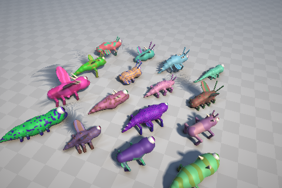

# Pixis

Ein Spiel über prozedurale Kreaturen, gebaut aus **Signed Distance Fields (SDF)** in einer eigenen WebGPU-Engine.
Jede Kreatur entsteht aus einem Genom, wird als weicher SDF-Körper per Raymarching gerendert,
prozedural animiert und bekommt über ihre Körperteile echte Fähigkeiten (laufen, schwimmen, fliegen, beißen, leuchten …).



## Starten

```bash
npm install
npm run dev        # http://localhost:5173
```

Braucht einen Browser mit WebGPU (aktueller Chrome/Edge, Safari ab 26, Chrome auf Android).

## Steuerung

| | Desktop | Handy |
|---|---|---|
| Bewegen | WASD / Pfeiltasten | linke Bildschirmhälfte ziehen |
| Kamera | Maus ziehen, Mausrad | rechte Hälfte ziehen |
| Springen / Fliegen / Gleiten | Leertaste (halten) | ⤴-Knopf |
| Beißen | E | 🦷 |
| Leuchten | G | ✨ |

## Modi & URL-Parameter

| Parameter | Bedeutung |
|---|---|
| `mode=game` / `gallery` / `test` | Spiel, 16er-Seed-Galerie (Tippen → spielen), handgebaute Testkreatur |
| `seed=123` | Kreatur aus Seed; `g=…` = geteiltes Genom (🔗 Teilen) |
| `debug=1…4` | Schrittanzahl-Heatmap, Normalen, Gruppen-IDs, Tile-Culling |
| `scale=0.5` | feste Renderauflösung (sonst dynamisch) |
| `frozen=N` | N feste Simulationsschritte, ein Bild (für Screenshot-Tests) |
| `at=x,z`, `hold=fwd,jump,bite,glow` | Startposition und gehaltene Eingaben (Tests/Demos) |

## Entwickeln

```bash
npm run lint && npm run typecheck && npm test   # schnell
npm run test:visual                             # Golden-Image-Vergleich (headless WebGPU)
npm run test:visual:update                      # Golden Images neu schreiben – vorher ansehen!
```

- 🗺️ Roadmap & Architektur: [`docs/PLAN.md`](docs/PLAN.md)
- 🔁 Arbeitsweise: [`docs/WORKFLOW.md`](docs/WORKFLOW.md)
- 🤖 Hinweise für Claude-Sessions: [`CLAUDE.md`](CLAUDE.md)

**Status:** M0–M6 umgesetzt (erste Version), siehe Plan.
